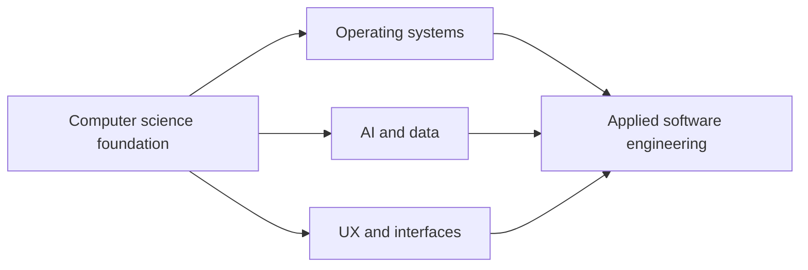

# M.S. Computer Science | Software Engineering

**Graduate coursework and applied projects at Southern New Hampshire University.**

  

[Portfolio](https://xtyledan.github.io/) · [GitHub Profile](https://github.com/xtyledan) · [MIT License](LICENSE)

## What this repository contains

A version-controlled record of coursework across operating systems, AI, data visualization, interface design and software engineering. Individual folders contain academic assignments, code and written work. **This is a collection of different exercises, not one deployable application.**

## Learning areas

*Conceptual map of study areas, not an application architecture diagram.*

| Course | Focus | Browse |
| --- | --- | --- |
| CS-510 | Operating systems, processes, concurrency and system resources | [Coursework](CS-510-Operating-Systems/) |
| CS-530 | AI concepts and applied problem solving | [Coursework](CS-530-Artificial-Intelligence-Principles-and-Applications/) |
| CS-540 | Data literacy, exploratory analysis and visualization | [Coursework](CS-540-Data%20Literacy%20%26%20Visualization/) |
| CS-560 | UI design, prototyping and evaluation | [Coursework](CS-560-UI-Design-and-Implementation/) |
| CS-600 | Software design, development and engineering decisions | [Coursework](CS-600-Software-Design-and-Development/) |

## How to explore and run assignments

1. Choose a course from the table and open the relevant module or assignment directory.
2. Read that directory's README or supporting instructions, where available.
3. Identify the language, inputs and dependencies of the selected exercise before running it.
4. Avoid assuming every directory uses the same environment or has an executable entry point.

**Example:** The [CS-510 operating systems exercises](CS-510-Operating-Systems/) include Python-based explorations of processes and system resources. Run individual scripts using their instructions rather than attempting to run the entire repository.

## Continuous integration

The following workflows are checked in:

- [Python coursework validation](.github/workflows/python-validation.yml)
- [Code quality](.github/workflows/code-quality.yml)
- [CodeQL analysis](.github/workflows/codeql.yml)

Workflow status is visible under [GitHub Actions](https://github.com/xtyledan/ms-computer-science-coursework/actions). A successful general repository check **does not guarantee that every independent assignment runs without additional requirements**.

## Engineering decisions

Organizing projects by course preserves context, while Git and automation make changes reviewable. A monorepository simplifies discovering work but also means assignments can have different dependencies and levels of completeness.

## Limits

No unified live deployment, single installation command or comprehensive integration test suite exists for this coursework collection. The conceptual diagram above is not a project screenshot. For runnable projects with actual captures and dedicated test suites, see [TkForge](https://github.com/xtyledan/TkForge-Visual-Tkinter-GUI-Builder) and [Animal Rescue Explorer](https://github.com/xtyledan/Animal-Rescue-Explorer-Local-Data-Dashboard).

**License:** [MIT](LICENSE). Individual academic content may have additional course or third-party restrictions; verify before redistributing.
